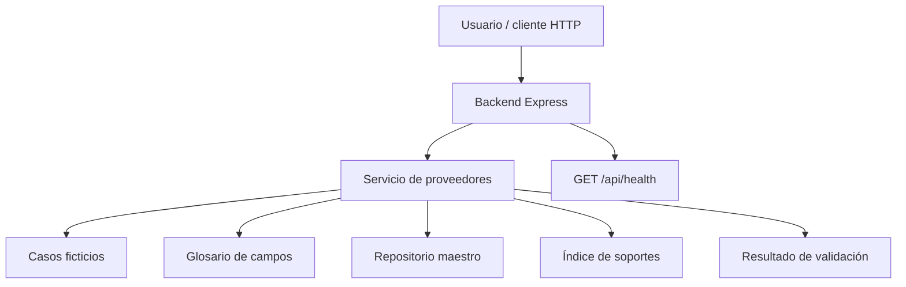

# SOLUCION.md — Reto técnico 01: Registro como Proveedor

## 1. Problema en una frase

El área administrativa necesita reducir la transcripción manual de datos al preparar formularios de registro como proveedor, utilizando información maestra y soportes disponibles, sin inventar datos ni delegar al agente las decisiones reservadas a una persona.

## 2. Arquitectura

La solución actual utiliza Node.js, TypeScript y Express para exponer una API HTTP. Los casos y el repositorio maestro son datos ficticios almacenados en archivos JSON.

**Separación actual:**
- **Interfaz:** la API puede consultarse mediante solicitudes HTTP. La interfaz conversacional completa está pendiente.
- **Backend:** `src/server.ts`, responsable de exponer los endpoints.
- **Lógica de negocio:** `src/providers/service.ts`, que consulta los casos, mapea campos y valida soportes.
- **Conocimiento y datos:** `fixtures/`, con casos, glosario y repositorio ficticio.
- **Configuración:** variables de entorno; el puerto utiliza `3002` por defecto.
- **Despliegue:** `render.yaml` define el servicio Node, los comandos de compilación y arranque y la ruta de verificación de salud.

La arquitectura conversacional completa prevista incorpora un prompt separado, un ciclo de agente, herramientas tipadas con Zod y un adaptador LLM. Estos componentes no deben considerarse terminados mientras no estén implementados e integrados.

## 3. Ciclo del agente

La versión disponible implementa un flujo determinista de prevalidación:

1. Recibe la identificación de un caso.
2. Recupera la solicitud y la plantilla correspondiente.
3. Compara los campos solicitados con el glosario y el repositorio maestro.
4. Identifica campos completos, faltantes o que requieren aclaración.
5. Comprueba los soportes disponibles y sus condiciones de vigencia o verificabilidad.
6. Devuelve un resultado que permite determinar si existen bloqueos para continuar.

El backend actual no debe presentarse como un ciclo de agente LLM completo. La orquestación de mensajes, las llamadas iterativas a herramientas y el control de confirmaciones dentro de una conversación requieren completar su integración.

**Control humano:** el agente no debe firmar ni enviar formularios por sí mismo. Antes de cualquier acción externa debe existir una confirmación explícita del usuario en el turno inmediatamente anterior. La confirmación debe verificarse en el backend, no únicamente en la interfaz.

## 4. Elección del modelo y costo estimado

El proyecto incluye dependencias para Google GenAI y Anthropic, pero disponer de los SDK no demuestra que exista una integración funcional.

- **Proveedor y modelo en producción:** pendientes de confirmar mediante una integración ejecutada y probada.
- **Criterio de elección:** calidad de respuesta, compatibilidad con llamadas a herramientas, latencia, límites de uso, protección de datos y costo.
- **Costo por caso:** no se declara una cifra porque todavía no se dispone de un modelo integrado, mediciones de tokens ni una tarifa confirmada.

Para estimarlo se debe medir el consumo real por caso y multiplicar los tokens de entrada y salida por las tarifas vigentes del modelo seleccionado. La clave debe configurarse como variable de entorno del backend y nunca publicarse en el repositorio, el frontend, los logs o las respuestas de la API.

## 5. Diseño del portal web

El formato de portal web con usuario y contraseña se considera un alcance de diseño, no una automatización implementada.

**Estrategia propuesta:** utilizar automatización de navegador controlada, por ejemplo Playwright, con selectores estables, validaciones antes de completar campos y evidencia de los resultados. Una alternativa es una solución RPA cuando las políticas de la organización lo requieran.

**Límites:** los cambios de interfaz pueden invalidar selectores; CAPTCHA y MFA pueden exigir intervención humana; las sesiones pueden expirar y el portal puede rechazar datos. Ante una condición no controlable, el proceso debe detenerse y reportar el problema sin fingir que el envío fue exitoso.

**Credenciales:** las introduce el usuario directamente en el portal o en un mecanismo seguro autorizado. No se almacenan en el repositorio, el prompt, los fixtures ni los logs. Si se requiere un gestor de secretos, debe utilizarse uno autorizado por la organización.

**Responsabilidades humanas:** el usuario inicia sesión, completa cualquier desafío de autenticación y realiza el clic final en “Enviar”. El agente puede preparar los valores, señalar campos pendientes y verificar visualmente el resultado, pero no suplanta la decisión del usuario.

## 6. Decisiones y trade-offs

| Decisión | Alternativa descartada | Justificación |
|---|---|---|
| Utilizar fixtures JSON para la demostración | Conectarse a sistemas empresariales reales | Permite reproducir escenarios sin exponer información ni depender de sistemas externos. |
| Separar la lógica de proveedores del servidor HTTP | Implementar toda la lógica dentro de los endpoints | Facilita las pruebas, la mantenibilidad y la reutilización. |
| Bloquear la preparación para firma cuando hay soportes vencidos o no verificables | Marcar el caso como listo pese a las inconsistencias | Evita presentar información no comprobada como válida. |
| Utilizar Express y TypeScript | Introducir un framework adicional sin necesidad demostrada | Mantiene una API sencilla y tipada para el prototipo. |

La integración del modelo, el contrato completo de herramientas y la generación de los formatos finales deben evaluarse como trabajo pendiente, no como capacidades demostradas por estas decisiones.

## 7. Supuestos

1. Los datos de los casos y del repositorio son ficticios y se utilizan únicamente para la demostración.
2. El repositorio maestro es la fuente autorizada para completar campos; los valores ausentes no se inventan.
3. Un soporte vencido, ausente o no verificable debe identificarse claramente y puede impedir que el paquete se considere listo para firma.
4. Los archivos de soporte incluidos como ejemplos no equivalen a documentos empresariales auténticos.
5. La automatización de portales y las integraciones con correo, firma electrónica o sistemas de clientes quedan fuera de la implementación actual.
6. El puerto local predeterminado es `3002`; el entorno de despliegue puede proporcionar otro mediante `PORT`.

## 8. Cobertura

| Historia / requisito | Estado actual | Pendiente |
|---|---|---|
| HU-1: leer la solicitud y reconocer campos | Parcial | Completar el contrato de salida y los casos ambiguos. |
| HU-2: mapear campos al maestro | Parcial | Verificar todos los estados y la trazabilidad exigida por el reto. |
| HU-3: generar formulario Excel/PDF | No demostrado como completo | Generar y validar los archivos en los formatos y rutas exigidos. |
| HU-3: portal web | Diseño documental | Producir el archivo de valores para copiar y documentar la estrategia de automatización. |
| HU-4: paquete para firma | Parcial | Completar generación de paquete, copias de soportes, checklist y borrador de correo. |
| HU-4: confirmación humana antes de enviar | No demostrado como completo | Implementar y probar el control de confirmación en el backend. |
| HU-5: manejo de errores | Parcial | Probar errores tipados y recuperación por caso. |
| API de salud | Hecho | Mantener la ruta disponible en el despliegue. |
| Compilación TypeScript | Hecho en la verificación local | Repetirla antes de cada publicación. |
| `demo.ts` sin modelo para todos los casos | Pendiente de validar | Verificar que ejecute todos los casos de manera reproducible. |
| Interfaz conversacional, historial y llamadas a herramientas visibles | Pendiente | Implementar e integrar el frontend con el ciclo del agente. |
| Adaptador LLM, prompt separado y límite de iteraciones | Pendiente de validar | Integrar y probar el ciclo conversacional. |
| Despliegue público | Configuración preparada | Completar el despliegue y comprobar la URL pública. |

**Estado general:** prototipo de backend de prevalidación con compilación y endpoint de salud comprobados localmente. No equivale todavía a la entrega integral del agente conversacional descrita por el reto.

## 9. Uso de IA

Se utilizó ChatGPT como asistente de desarrollo para:
- Analizar requisitos y organizar la arquitectura.
- Apoyar la construcción y revisión del código TypeScript.
- Diagnosticar errores de configuración y compilación.
- Preparar documentación técnica y configuración de despliegue.

Las propuestas se deben contrastar con el código, los requisitos y las pruebas reales. No se consideran implementadas únicamente por haber sido sugeridas por una herramienta de IA. La responsabilidad de revisar, comprender y defender el código entregado corresponde al autor.

No se declara el uso de otros asistentes como hecho si no se han utilizado efectivamente.

## 10. Riesgos de producción y mitigaciones

| Riesgo | Mitigación |
|---|---|
| Datos ficticios o desactualizados | Validar el origen, la vigencia y la autorización de cada dato antes de usarlo en producción. |
| Campos mapeados incorrectamente | Exigir trazabilidad hacia el maestro y pedir aclaración cuando el mapeo sea ambiguo. |
| Soportes vencidos o no verificables | Bloquear la preparación para firma cuando corresponda y mostrar el motivo. |
| Exposición de claves o información sensible | Usar variables de entorno y gestores de secretos autorizados; evitar secretos en logs y respuestas. |
| Uso excesivo del modelo | Configurar límites de iteraciones, tokens, tiempo de espera y costo por sesión. |
| Fallos del modelo o de servicios externos | Manejar errores tipados, timeouts y respuestas recuperables. |
| Acciones externas sin autorización | Exigir confirmación humana validada en el backend. |
| Cambios en portales web | Utilizar pruebas de regresión, selectores robustos y escalamiento al usuario cuando cambie la interfaz. |
| Despliegue inaccesible o fallido | Mantener un endpoint de salud y verificar la compilación y la disponibilidad tras publicar. |

## Cierre

La solución prioriza una base verificable para la prevalidación de solicitudes de registro como proveedor. Las funcionalidades declaradas como parciales o pendientes deben completarse y probarse antes de afirmar que se satisfacen todos los criterios del reto.
